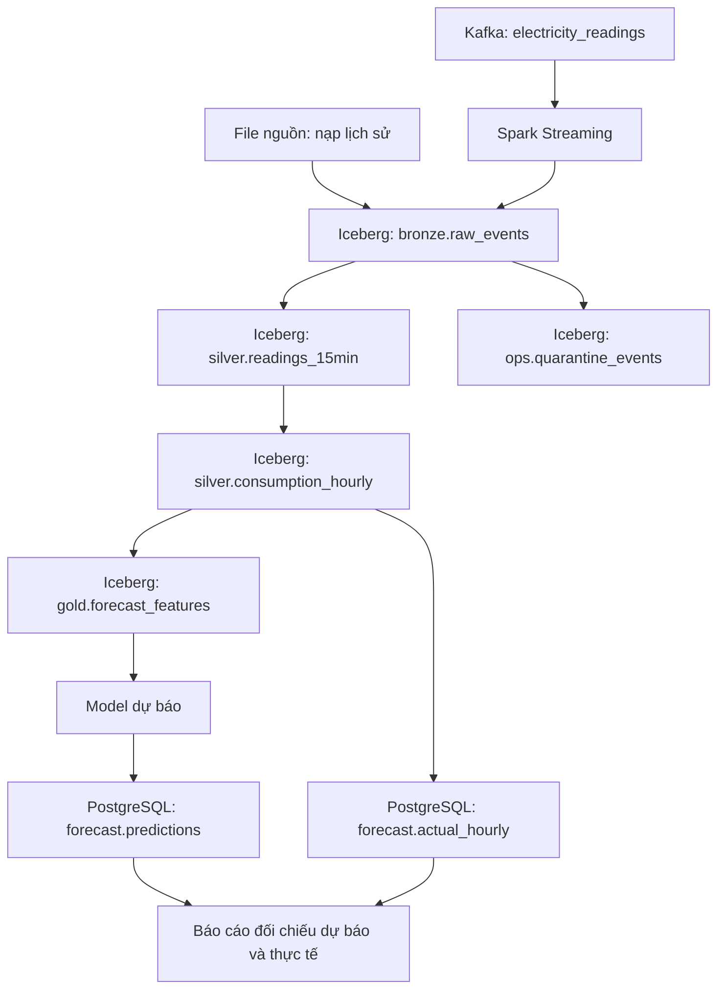

# Bảng dữ liệu và lưu trữ — Electricity Forecasting

Tài liệu đối chiếu với mã nguồn tại ngày 21/11/2026. Phạm vi là các bảng, vị trí lưu trữ, cột, khóa, cách tạo/đọc/ghi và trạng thái triển khai hiện tại. Đây là mô tả từ code, chưa phải kết quả kiểm kê database/container đang chạy.

## 1. Tổng quan nơi lưu dữ liệu

Code hiện định nghĩa **5 bảng Iceberg** cho dữ liệu xử lý và **5 bảng PostgreSQL nghiệp vụ** cho kết quả, trạng thái. PostgreSQL còn có database riêng phục vụ JDBC catalog của Iceberg.

| Thành phần | Nơi lưu theo cấu hình mẫu | Vai trò |
|---|---|---|
| Kafka | Topic `electricity_readings`; volume `kafka-data` | Giữ message đầu vào trước khi Spark đọc. Topic không phải bảng SQL. |
| HDFS | `hdfs://namenode:8020/electricity` | Lưu file bảng Iceberg, thư mục nguồn, model, checkpoint và Spark event log. |
| Iceberg warehouse | `hdfs://namenode:8020/electricity/warehouse` | Chứa file dữ liệu Parquet và các file metadata của bảng Iceberg. |
| PostgreSQL nghiệp vụ | Database `electricity`, lấy tên từ `PGDATABASE` | Lưu 5 bảng trong schema `ops` và `forecast`. |
| PostgreSQL catalog | Database `iceberg_catalog`, lấy tên từ `ICEBERG_DATABASE` | JDBC catalog quản lý đăng ký bảng/namespace và tham chiếu vị trí metadata Iceberg. Các dòng số đo không được lưu trong database này. |
| Báo cáo local | `electricity_forecast/reports/`, mount thành `/app/reports` trong runner | Nơi dành cho artifact báo cáo; luồng xuất báo cáo còn chưa triển khai. |

Các tên database ở trên là giá trị mẫu trong `.env.example` và giá trị mặc định trong Compose; tên hiệu lực lấy từ môi trường chạy. Không đọc mật khẩu từ tài liệu này.

### Sơ đồ luồng nghiệp vụ dự kiến



Sơ đồ mô tả các bước cần nối. Hiện các module `replay.py`, `stream.py`, `processing.py`, `features.py`, `ml.py` vẫn rỗng; chưa có pipeline tự động tạo toàn bộ dữ liệu trong sơ đồ.

## 2. Code tạo bảng và cấu hình nằm ở đâu?

| File | Thành phần cần xem | Chức năng |
|---|---|---|
| [local.yaml](/E:/dowload/project_bigdata/electricity_forecast/configs/local.yaml) | `hdfs`, `iceberg`, `postgres` | Khai báo root HDFS, alias catalog, ánh xạ tên bảng và tên biến môi trường kết nối. |
| [config.py](/E:/dowload/project_bigdata/electricity_forecast/src/electricity_forecast/config.py) | `Settings.warehouse`, `Settings.table()`, `postgres_kwargs()` | Ghép warehouse từ root HDFS; ghép tên bảng đầy đủ; chọn database nghiệp vụ hoặc catalog. |
| [storage.py](/E:/dowload/project_bigdata/electricity_forecast/src/electricity_forecast/storage.py) | `ICEBERG_SCHEMAS`, `PARTITIONS` | Định nghĩa cột và partition của 5 bảng Iceberg. |
| [storage.py](/E:/dowload/project_bigdata/electricity_forecast/src/electricity_forecast/storage.py) | `create_spark()` | Nối Spark với JDBC catalog PostgreSQL và warehouse HDFS. |
| [storage.py](/E:/dowload/project_bigdata/electricity_forecast/src/electricity_forecast/storage.py) | `init_iceberg_tables()` | Thực thi SQL tạo namespace và bảng Iceberg. |
| [001_initial.sql](/E:/dowload/project_bigdata/electricity_forecast/sql/001_initial.sql) | Các lệnh `CREATE SCHEMA`, `CREATE TABLE`, `CREATE INDEX` | Định nghĩa đầy đủ 5 bảng PostgreSQL nghiệp vụ. |
| [storage.py](/E:/dowload/project_bigdata/electricity_forecast/src/electricity_forecast/storage.py) | `init_postgres()` | Đọc và thực thi file SQL trong một transaction. |
| [infrastructure.py](/E:/dowload/project_bigdata/electricity_forecast/src/electricity_forecast/infrastructure.py) | `initialize()` | Điều phối tạo bảng PostgreSQL rồi tạo Spark và bảng Iceberg. |
| [cli.py](/E:/dowload/project_bigdata/electricity_forecast/src/electricity_forecast/cli.py) | Lệnh `init`, `check-infra` | Điểm gọi từ dòng lệnh và Compose. |
| [compose.yaml](/E:/dowload/project_bigdata/electricity_forecast/compose.yaml) | `postgres`, `hdfs-init`, `kafka-init`, `init`, `volumes` | Dựng dịch vụ, tạo thư mục HDFS/topic Kafka, chạy khởi tạo bảng, gắn volume lưu bền. |
| [postgres-init.sh](/E:/dowload/project_bigdata/electricity_forecast/infra/postgres-init.sh) | Script entrypoint PostgreSQL | Tạo role/database catalog nếu chưa có; chạy khi khởi tạo volume PostgreSQL mới. Database nghiệp vụ được image PostgreSQL tạo qua `POSTGRES_DB`. |
| [metrics.py](/E:/dowload/project_bigdata/electricity_forecast/src/electricity_forecast/metrics.py) | `start_run()`, `finish_run()`, `start_job()`, `finish_job()`, `record_forecast_status()` | Ghi/cập nhật các bảng vận hành PostgreSQL. |
| [contracts.py](/E:/dowload/project_bigdata/electricity_forecast/src/electricity_forecast/contracts.py) | Các hằng khóa và `ReadingEvent` | Quy ước khóa nghiệp vụ, thời gian, đơn vị và kiểm tra sự kiện số đo. |

Luồng khởi tạo trong code:

```text
Compose
├── postgres: tạo database nghiệp vụ và database catalog trên volume mới
├── hdfs-init: tạo các thư mục gốc
├── kafka-init: tạo/kiểm tra topic
└── init: python3 -m electricity_forecast.cli init
    └── infrastructure.initialize(settings)
        ├── settings.validate_connections()
        ├── storage.init_postgres(settings)
        │   └── chạy sql/001_initial.sql
        ├── storage.create_spark(settings)
        └── storage.init_iceberg_tables(spark, settings)
```

`init` tạo cấu trúc bảng, không nạp lịch sử hay tạo dự báo. Chạy lại dùng `IF NOT EXISTS`, không drop bảng cũ. Với Iceberg, code còn so sánh tên cột, kiểu và nullability của bảng đã tồn tại. Với PostgreSQL, file SQL không tự migrate schema cũ; code có bước chặn các cột thời gian cũ dùng `timestamptz`.

## 3. Vị trí logic, vị trí file và volume vật lý

### 3.1. Tên bảng Iceberg

`Settings.table(key)` ghép alias catalog và giá trị `iceberg.tables[key]`:

```text
lakehouse.silver.readings_15min
───────── ────── ──────────────
catalog   namespace  tên bảng
```

| Khóa trong YAML | Tên đầy đủ mặc định khi Spark truy vấn | Nơi lưu file |
|---|---|---|
| `iceberg.tables.bronze` | `lakehouse.bronze.raw_events` | Warehouse HDFS; location cụ thể do catalog/Iceberg xác định. |
| `iceberg.tables.readings` | `lakehouse.silver.readings_15min` | Warehouse HDFS; location cụ thể do catalog/Iceberg xác định. |
| `iceberg.tables.hourly` | `lakehouse.silver.consumption_hourly` | Warehouse HDFS; location cụ thể do catalog/Iceberg xác định. |
| `iceberg.tables.features` | `lakehouse.gold.forecast_features` | Warehouse HDFS; location cụ thể do catalog/Iceberg xác định. |
| `iceberg.tables.quarantine` | `lakehouse.ops.quarantine_events` | Warehouse HDFS; location cụ thể do catalog/Iceberg xác định. |

Code không gán `LOCATION` riêng cho từng bảng. Không nên coi đường dẫn tự ghép từ tên namespace/bảng là đường dẫn đã kiểm chứng. Muốn biết location thực tế, xem mục 9.

`lakehouse.ops.quarantine_events` là bảng Iceberg trên HDFS. Nó thuộc hệ thống khác với `ops.runs` trong PostgreSQL, dù đều có nhóm tên `ops`.

### 3.2. Các thư mục HDFS

Service `hdfs-init` tạo các thư mục sau dưới `hdfs.root_uri`:

```text
hdfs://namenode:8020/electricity/
├── source/         # dành cho bản nguồn/checksum; chưa có code nạp nguồn
├── warehouse/      # file dữ liệu và metadata của bảng Iceberg
├── models/         # dành cho model; chưa có code lưu model
├── checkpoints/    # dành cho tiến độ streaming; stream chưa triển khai
└── spark-events/   # Spark event log, được create_spark() cấu hình sử dụng
```

Tạo thư mục chưa đồng nghĩa đã ghi dữ liệu vào đó. Checkpoint theo `<run_id>/<query_name>/` mới là quy ước thiết kế, chưa được `stream.py` thực hiện.

### 3.3. Docker volume và thư mục bên trong container

| Thành phần | Tên volume trong Compose | Mount trong container | Nội dung |
|---|---|---|---|
| PostgreSQL | `postgres18-data` | `/var/lib/postgresql` | File của database nghiệp vụ và database catalog. Đây là mount gốc; xem `SHOW data_directory` để biết thư mục database hiệu lực. |
| HDFS NameNode | `namenode-data` | `/hadoop/dfs/name` | Metadata hệ thống file HDFS. |
| HDFS DataNode | `datanode-data` | `/hadoop/dfs/data` | Các block chứa nội dung file HDFS. |
| Kafka | `kafka-data` | `/var/lib/kafka/data` | Log message của topic Kafka. |
| Spark | `ivy-cache` | `/tmp/.ivy2` | Cache JAR phụ thuộc; không phải dữ liệu bảng. |

Đây là **named volume do Docker quản lý**, không phải các thư mục cùng tên trong project. Tên volume thực tế thường có tiền tố project Compose; cần inspect runtime để biết chính xác. Không giả định chúng là đường dẫn thư mục trực tiếp trên ổ E:.

HDFS có URI logic `/electricity/...`, nhưng nội dung vật lý được lưu thành block trong DataNode; không tìm nguyên đường dẫn HDFS bên dưới `/hadoop/dfs/data` như một cây thư mục thông thường. `hdfs-site.xml` hiện đặt `dfs.replication = 1`.

Runner còn mount `data/` thành `/app/data` ở chế độ chỉ đọc và `reports/` thành `/app/reports` để xuất artifact. Các bind mount này khác named volume chứa bảng.

## 4. Quy ước đọc các schema dưới đây

- **NULL: Không** nghĩa là cột bắt buộc; **NULL: Có** nghĩa là được để NULL. PostgreSQL primary key cũng ngầm bắt buộc NOT NULL.
- Timestamp nguồn dùng giờ ghi trong dữ liệu, không mang múi giờ: Spark/Iceberg dùng `TIMESTAMP_NTZ`, PostgreSQL dùng `timestamp without time zone`.
- Timestamp số đo là **cuối khoảng đo**. `reading_end = 10:15` tương ứng khoảng `10:00–10:15`.
- Công suất có đơn vị **kW**. Trung bình 4 số đo 15 phút cho công suất trung bình giờ; không tự coi tổng hoặc trung bình này là kWh.
- `run_id` phân biệt các lần chạy; cùng khách hàng và thời điểm nhưng khác `run_id` vẫn là các bản ghi khác nhau.
- Khóa Iceberg bên dưới là khóa mà hàm Python dùng khi MERGE, không phải primary key/foreign key SQL đã được khai báo trên bảng Iceberg.
- Mô tả ý nghĩa nghiệp vụ không đồng nghĩa mọi quy tắc đều đã được DDL cưỡng chế. Các giới hạn này được ghi riêng theo từng bảng.

## 5. Chi tiết 5 bảng Iceberg

Các schema lấy từ `storage.ICEBERG_SCHEMAS`. Tất cả bảng được tạo với `USING iceberg`, `format-version = 2`, định dạng ghi mặc định `parquet`. Không có default tự sinh cho các cột trong DDL Iceberg hiện tại; bên ghi phải chuẩn bị giá trị.

### 5.1. `lakehouse.bronze.raw_events`

Giữ sự kiện gốc trước khi chuẩn hóa. Một sự kiện Kafka được nhận diện bằng thông tin giao nhận; hai message khác offset có thể chứa cùng một số đo nghiệp vụ.

- Khóa MERGE: `(run_id, event_id)`.
- Partition: `run_id, days(received_at)` — ngày nhận, không phải ngày đo điện.
- Hàm ghi: `append_bronze()`; bên trong vẫn dùng `merge_rows()` để chống ghi lặp sự kiện.

| Cột | Kiểu | NULL | Ý nghĩa |
|---|---|---|---|
| `event_id` | `STRING` | Không | ID ổn định của sự kiện; quy ước Kafka dựa trên topic/partition/offset, batch dựa trên checksum nguồn/dòng/khách hàng. Chưa có adapter sinh ID. |
| `run_id` | `STRING` | Không | Lần chạy sở hữu sự kiện. |
| `source` | `STRING` | Không | Nhãn nguồn. |
| `raw_payload` | `STRING` | Không | Nội dung gốc, lưu dưới dạng chuỗi. |
| `received_at` | `TIMESTAMP_NTZ` | Không | Thời điểm nhận sự kiện. |
| `producer_sent_at` | `TIMESTAMP_NTZ` | Có | Thời điểm producer gửi, nếu có. |
| `kafka_topic` | `STRING` | Có | Topic của sự kiện Kafka. |
| `kafka_partition` | `INT` | Có | Partition Kafka. |
| `kafka_offset` | `BIGINT` | Có | Offset trong partition. |
| `source_file` | `STRING` | Có | Tham chiếu file nguồn của nhánh batch. |
| `source_row_number` | `BIGINT` | Có | Số dòng nguồn của nhánh batch. |

Các cột Kafka/file được phép NULL để dùng chung schema cho hai nguồn. DDL chưa ép điều kiện phải có đủ một trong hai bộ thông tin nguồn.

### 5.2. `lakehouse.silver.readings_15min`

Mỗi dòng là một số đo 15 phút hợp lệ của một khách hàng sau chuẩn hóa và chống trùng nghiệp vụ.

- Khóa MERGE: `(run_id, customer_id, reading_end)`; khai báo tại `contracts.READING_KEY`.
- Partition: `run_id, days(reading_end)`.
- Hàm ghi: `merge_readings()`.

| Cột | Kiểu | NULL | Ý nghĩa |
|---|---|---|---|
| `run_id` | `STRING` | Không | Lần chạy. |
| `customer_id` | `STRING` | Không | ID khách hàng/điểm tiêu thụ. |
| `interval_start` | `TIMESTAMP_NTZ` | Không | Đầu khoảng đo. |
| `reading_end` | `TIMESTAMP_NTZ` | Không | Cuối khoảng đo, tham gia khóa nghiệp vụ. |
| `power_kw` | `DOUBLE` | Không | Công suất của khoảng đo, đơn vị kW. |
| `source` | `STRING` | Không | Nhãn nguồn. |
| `source_event_id` | `STRING` | Không | ID sự kiện Bronze dùng để truy vết. |
| `processed_at` | `TIMESTAMP_NTZ` | Không | Thời điểm xử lý. |

`ReadingEvent` trong `contracts.py` có kiểm tra khoảng dài đúng 15 phút, bám lưới 15 phút, công suất hữu hạn và không âm; giá trị 0 hợp lệ. DDL bảng không chứa các CHECK này, và `merge_readings()` không tự gọi `ReadingEvent`. Job xử lý sau này phải thực hiện validation trước khi ghi. `source_event_id` là liên kết logic, chưa có foreign key cưỡng chế tới Bronze.

### 5.3. `lakehouse.silver.consumption_hourly`

Mỗi dòng theo dõi một giờ của một khách hàng, bao gồm cả giờ chưa đủ mẫu.

- Khóa MERGE: `(run_id, customer_id, hour_start)`; khai báo tại `contracts.HOURLY_KEY`.
- Partition: `run_id, days(hour_start)`.
- Hàm ghi: `merge_hourly()`.

| Cột | Kiểu | NULL | Ý nghĩa |
|---|---|---|---|
| `run_id` | `STRING` | Không | Lần chạy. |
| `customer_id` | `STRING` | Không | Khách hàng. |
| `hour_start` | `TIMESTAMP_NTZ` | Không | Đầu giờ tổng hợp. |
| `hour_end` | `TIMESTAMP_NTZ` | Không | Cuối giờ tổng hợp. |
| `hourly_avg_kw` | `DOUBLE` | Có | Công suất trung bình giờ; có thể NULL khi thiếu dữ liệu. |
| `sample_count` | `INT` | Không | Số khoảng đo đã dùng. |
| `status` | `STRING` | Không | Trạng thái độ đầy đủ, ví dụ `WAITING_FOR_DATA`. |
| `missing_intervals` | `ARRAY<TIMESTAMP_NTZ>` | Có | Danh sách mốc còn thiếu, cần thống nhất trong job tổng hợp. |
| `source_snapshot_id` | `BIGINT` | Không | Snapshot của bảng nguồn dùng khi tổng hợp. |
| `updated_at` | `TIMESTAMP_NTZ` | Không | Thời điểm cập nhật. |

Quy ước nghiệp vụ là chỉ tính trung bình hoàn chỉnh khi có đủ 4 khoảng 15 phút khác nhau. DDL Iceberg hiện chưa ép `sample_count = 4`, chưa giới hạn tập giá trị `status`, chưa kiểm tra độ dài giờ. Hàm ghi cho phép sửa giá trị nghiệp vụ khi bản cũ có `status = 'WAITING_FOR_DATA'` và `sample_count` mới lớn hơn cũ. Job tổng hợp còn chưa triển khai, nên điều kiện MERGE này chưa thay thế toàn bộ kiểm tra chất lượng.

### 5.4. `lakehouse.gold.forecast_features`

Mỗi dòng là bộ đặc trưng cho một khách hàng tại một `forecast_origin`.

- Khóa MERGE: `(run_id, customer_id, forecast_origin)`; khai báo tại `contracts.FEATURE_KEY`.
- Partition: `run_id, days(forecast_origin)`.
- Hàm ghi: `merge_features()`.

| Cột | Kiểu | NULL | Ý nghĩa |
|---|---|---|---|
| `run_id` | `STRING` | Không | Lần chạy. |
| `customer_id` | `STRING` | Không | Khách hàng. |
| `forecast_origin` | `TIMESTAMP_NTZ` | Không | Mốc đưa ra dự báo. |
| `target_start` | `TIMESTAMP_NTZ` | Không | Đầu khoảng mục tiêu. |
| `target_end` | `TIMESTAMP_NTZ` | Không | Cuối khoảng mục tiêu. |
| `last_completed_hour_kw` | `DOUBLE` | Không | Công suất trung bình giờ vừa hoàn tất tại/trước origin. |
| `same_target_hour_previous_day_kw` | `DOUBLE` | Không | Công suất cùng khoảng mục tiêu của ngày trước. |
| `same_target_hour_previous_week_kw` | `DOUBLE` | Không | Công suất cùng khoảng mục tiêu của tuần trước. |
| `mean_previous_24h_kw` | `DOUBLE` | Không | Trung bình của 24 giờ hoàn tất gần nhất. |
| `target_hour` | `INT` | Không | Giờ trong ngày của mục tiêu. |
| `target_day_of_week` | `INT` | Không | Thứ trong tuần của mục tiêu; code tạo feature chưa chốt cách đánh số. |
| `source_snapshots` | `MAP<STRING, BIGINT>` | Không | Ánh xạ nguồn sang snapshot ID để truy lại đầu vào. |
| `created_at` | `TIMESTAMP_NTZ` | Không | Thời điểm tạo bộ đặc trưng. |

Schema không có cột nhãn training hay dự báo. Theo thiết kế, nhãn sẽ được ghép từ dữ liệu hourly khi huấn luyện; kết quả dự báo lưu ở PostgreSQL. Các bước đó còn chưa triển khai.

### 5.5. `lakehouse.ops.quarantine_events`

Giữ payload lỗi và lý do. Một sự kiện có thể có nhiều dòng nếu có nhiều `reason_code`.

- Khóa MERGE: `(run_id, event_id, reason_code)`.
- Partition: `run_id`.
- Hàm ghi: `merge_quarantine()`.

| Cột | Kiểu | NULL | Ý nghĩa |
|---|---|---|---|
| `run_id` | `STRING` | Không | Lần chạy. |
| `event_id` | `STRING` | Không | Sự kiện liên quan. |
| `raw_payload` | `STRING` | Không | Nội dung gốc để điều tra. |
| `reason_code` | `STRING` | Không | Mã loại lỗi; chưa có enum cưỡng chế trong DDL. |
| `reason_detail` | `STRING` | Có | Mô tả chi tiết. |
| `quarantined_at` | `TIMESTAMP_NTZ` | Không | Thời điểm ghi nhận lỗi. |

## 6. Chi tiết 5 bảng PostgreSQL nghiệp vụ

Nguồn định nghĩa: `sql/001_initial.sql`. Các bảng thuộc database được chọn bởi `PGDATABASE`; với cấu hình mẫu là `electricity`. DDL hiện tạo trực tiếp schema `ops`, `forecast`; tên hai schema này cũng được validator chốt cố định.

Trong các bảng dưới đây, viết ngắn `timestamp` để chỉ chính xác kiểu `timestamp without time zone`. Các bảng không có khai báo partition PostgreSQL.

### 6.1. `electricity` → `ops.runs`

Một dòng là một lần chạy tổng thể. Primary key: `(run_id)`.

| Cột | Kiểu | NULL | Default | Ý nghĩa |
|---|---|---|---|---|
| `run_id` | `text` | Không | Không | ID lần chạy, phải có nội dung sau trim. |
| `run_type` | `text` | Không | Không | Loại lần chạy: `INIT`, `DEMO`, `BENCHMARK`, `TEST`. |
| `config` | `jsonb` | Không | Không | Cấu hình YAML đã đọc; `start_run()` lưu `settings.data`, không lưu toàn bộ môi trường. |
| `status` | `text` | Không | Không | `RUNNING`, `SUCCESS`, `FAILED`, `CANCELLED`. |
| `started_at` | `timestamp` | Không | `LOCALTIMESTAMP` | Bắt đầu lần chạy. |
| `completed_at` | `timestamp` | Có | Không | Kết thúc lần chạy. |
| `error_message` | `text` | Có | Không | Thông báo lỗi. |

CHECK yêu cầu thời điểm kết thúc không trước bắt đầu; `RUNNING` tương đương với chưa có `completed_at`. `start_run()` không cho tái sử dụng ID đã kết thúc hoặc cùng ID với loại/cấu hình khác. `finish_run()` cập nhật trạng thái cuối. Lệnh `init` hiện không tự gọi `start_run()`, dù DDL cho phép `run_type = INIT`.

### 6.2. `electricity` → `ops.job_runs`

Một dòng là một lần thực thi/thử lại của một job.

- Primary key: `(execution_id)`.
- Foreign key: `run_id` → `ops.runs(run_id)`.
- UNIQUE: `(run_id, job_key, attempt)`.
- Index bổ sung: `job_runs_lookup(run_id, job_name, started_at)`.

| Cột | Kiểu | NULL | Default | Ý nghĩa |
|---|---|---|---|---|
| `execution_id` | `uuid` | Không | Không | ID thực thi; `start_job()` sinh UUID. |
| `run_id` | `text` | Không | Không | Lần chạy cha. |
| `job_key` | `text` | Không | Không | Khóa logic để nhóm các lần thử cùng công việc. |
| `job_name` | `text` | Không | Không | Tên job. |
| `attempt` | `integer` | Không | Không | Số lần thử, phải > 0. |
| `status` | `text` | Không | Không | `RUNNING`, `SUCCESS`, `FAILED`. |
| `source_snapshots` | `jsonb` | Không | `'{}'::jsonb` | Snapshot đầu vào. |
| `input_rows` | `bigint` | Có | Không | Số dòng vào; nếu có phải >= 0. |
| `output_rows` | `bigint` | Có | Không | Số dòng ra; nếu có phải >= 0. |
| `metrics` | `jsonb` | Không | `'{}'::jsonb` | Metric của job, ví dụ `runtime_seconds`. |
| `started_at` | `timestamp` | Không | `LOCALTIMESTAMP` | Thời điểm bắt đầu. |
| `completed_at` | `timestamp` | Có | Không | Thời điểm kết thúc. |
| `error_message` | `text` | Có | Không | Lỗi của lần thực thi. |

CHECK về thời gian/trạng thái tương tự `ops.runs`. `start_job()` yêu cầu run cha đang `RUNNING`, khóa dòng run khi xác định `attempt`. `track_job()` đo thời gian và ghi thành công/thất bại qua `finish_job()`.

### 6.3. `electricity` → `ops.forecast_status`

Một dòng theo dõi tình trạng dự báo của một khách hàng tại một origin, độc lập với việc đã có giá trị dự báo hay chưa.

- Primary key: `(run_id, customer_id, forecast_origin)`.
- Foreign key: `run_id` → `ops.runs(run_id)`.
- Hàm ghi: `record_forecast_status()` dùng `INSERT ... ON CONFLICT ... DO UPDATE`.

| Cột | Kiểu | NULL | Default | Ý nghĩa |
|---|---|---|---|---|
| `run_id` | `text` | Không | Không | Lần chạy. |
| `customer_id` | `text` | Không | Không | Khách hàng, không được rỗng sau trim. |
| `forecast_origin` | `timestamp` | Không | Không | Mốc dự báo, phải tròn giờ. |
| `target_start` | `timestamp` | Không | Không | Bắt đầu mục tiêu, bằng origin + 1 giờ. |
| `target_end` | `timestamp` | Không | Không | Kết thúc mục tiêu, bằng target_start + 1 giờ. |
| `status` | `text` | Không | Không | `WAITING_FOR_DATA`, `MISSING_FEATURES`, `READY`, `GENERATED`, `LATE`, `FAILED`. |
| `reason` | `text` | Có | Không | Lý do của trạng thái. |
| `missing_intervals` | `timestamp[]` | Không | `'{}'` | Các mốc thời gian còn thiếu. |
| `updated_at` | `timestamp` | Không | `LOCALTIMESTAMP` | Lần cập nhật gần nhất. |

### 6.4. `electricity` → `forecast.predictions`

Một dòng là một dự báo của một khách hàng tại một origin, cho một phiên bản model.

- Primary key: `(run_id, customer_id, forecast_origin, target_start, model_version)`.
- Foreign key: `run_id` → `ops.runs(run_id)`.
- Index bổ sung: `predictions_target_lookup(run_id, customer_id, target_start)`.
- Chưa có hàm ứng dụng ghi dự báo trong `storage.py`; hiện có DDL và kiểm thử PostgreSQL.

| Cột | Kiểu | NULL | Default | Ý nghĩa |
|---|---|---|---|---|
| `run_id` | `text` | Không | Không | Lần chạy. |
| `customer_id` | `text` | Không | Không | Khách hàng, không được rỗng sau trim. |
| `forecast_origin` | `timestamp` | Không | Không | Mốc đưa ra dự báo, phải tròn giờ. |
| `target_start` | `timestamp` | Không | Không | Đầu khoảng mục tiêu, origin + 1 giờ. |
| `target_end` | `timestamp` | Không | Không | Cuối khoảng mục tiêu, target_start + 1 giờ. |
| `model_version` | `text` | Không | Không | Phiên bản model, không được rỗng sau trim. |
| `predicted_kw` | `double precision` | Không | Không | Công suất dự báo, phải >= 0 và < Infinity. |
| `baseline_kw` | `double precision` | Có | Không | Dự báo đối chứng; nếu có phải >= 0 và < Infinity. |
| `generated_at` | `timestamp` | Không | Không | Thời điểm tạo dự báo, bên ghi phải cung cấp. |
| `source_snapshots` | `jsonb` | Không | `'{}'::jsonb` | Snapshot dữ liệu dùng để tạo dự báo. |

Ví dụ: origin `2013-12-31 09:00` dự báo công suất trung bình cho khoảng `10:00–11:00`. Primary key ngăn thêm hai dòng cùng khóa nhưng chưa tự bảo đảm retry phải giữ cùng giá trị; logic ghi dự báo sau này phải xử lý xung đột giá trị.

### 6.5. `electricity` → `forecast.actual_hourly`

Lưu số thực tế theo giờ được xuất từ dữ liệu đã tổng hợp, phục vụ đối chiếu dự báo.

- Primary key: `(run_id, customer_id, hour_start)`.
- Foreign key: `run_id` → `ops.runs(run_id)`.
- Chưa có hàm ứng dụng xuất actual từ Iceberg sang PostgreSQL.

| Cột | Kiểu | NULL | Default | Ý nghĩa |
|---|---|---|---|---|
| `run_id` | `text` | Không | Không | Lần chạy. |
| `customer_id` | `text` | Không | Không | Khách hàng, không được rỗng sau trim. |
| `hour_start` | `timestamp` | Không | Không | Đầu giờ thực tế, phải tròn giờ. |
| `hour_end` | `timestamp` | Không | Không | Cuối giờ, bằng hour_start + 1 giờ. |
| `actual_kw` | `double precision` | Không | Không | Công suất trung bình thực tế, phải >= 0 và < Infinity. |
| `sample_count` | `integer` | Không | Không | Phải bằng 4; bảng này chỉ nhận giờ đủ mẫu. |
| `source_table` | `text` | Không | Không | Tên bảng nguồn, dự kiến là bảng hourly Iceberg. |
| `source_snapshot_id` | `bigint` | Không | Không | Snapshot nguồn để truy vết. |
| `updated_at` | `timestamp` | Không | `LOCALTIMESTAMP` | Thời điểm cập nhật. |

Khác với bảng hourly trên Iceberg có thể chứa giờ đang thiếu mẫu, `actual_hourly` có CHECK cưỡng chế `sample_count = 4`. DDL kiểm tra số lượng, chưa tự chứng minh đó là 4 khoảng đo hợp lệ khác nhau; việc này thuộc job xử lý.

## 7. Khóa, quan hệ và chống ghi trùng

### 7.1. Các quan hệ

Trong PostgreSQL, cả bốn bảng `ops.job_runs`, `ops.forecast_status`, `forecast.predictions`, `forecast.actual_hourly` có foreign key tới `ops.runs`. Không có bảng dimension khách hàng trong DDL hiện tại; `customer_id` là chuỗi được truyền theo dữ liệu.

Các quan hệ sau là quan hệ logic, chưa có foreign key xuyên hệ thống:

| Nguồn | Đích | Cách liên hệ |
|---|---|---|
| Bronze | Silver readings | `run_id` + `source_event_id` tham chiếu `event_id`. |
| Bronze | Quarantine | `run_id` + `event_id`. |
| Silver readings | Hourly | Tổng hợp theo `run_id`, `customer_id`, giờ; lưu snapshot nguồn. |
| Hourly | Features | Tạo đặc trưng tại origin từ các khoảng lịch sử phù hợp. |
| Features | Predictions | `run_id`, `customer_id`, `forecast_origin`; kết quả có thêm phiên bản model. |
| Predictions | Actual hourly | Đối chiếu cùng `run_id`, `customer_id`, `target_start = hour_start`, `target_end = hour_end`. |

Các bước tổng hợp/ghép dữ liệu trong bảng trên chưa được triển khai thành pipeline. Khi so sánh dự báo với actual, ghép theo **khoảng mục tiêu**, không ghép `forecast_origin` với `hour_start` của actual.

### 7.2. `merge_rows()` đang bảo vệ dữ liệu Iceberg thế nào?

Các hàm `append_bronze`, `merge_readings`, `merge_hourly`, `merge_features`, `merge_quarantine` dùng chung `merge_rows()`:

1. Kiểm tra đầu vào có đủ cột và đúng tập tên cột của bảng đích.
2. Chặn NULL ở các cột khóa.
3. Chặn cùng khóa nhưng khác các giá trị nghiệp vụ được chọn để so sánh trong một batch.
4. Loại bản ghi trùng khóa trong batch.
5. Kiểm tra bảng đích chưa có khóa trùng.
6. Chặn ghi lại cùng khóa với giá trị nghiệp vụ khác, trừ cập nhật hourly được phép.
7. Thực thi `MERGE INTO`; thêm dòng chưa có, giữ dòng đã có khi dữ liệu tương đương.
8. Trả về snapshot hiện tại của bảng sau thao tác.

Các timestamp xử lý không được dùng để xác định xung đột nghiệp vụ. Không phải mọi cột truy vết cũng nằm trong `value_columns`; ví dụ snapshot/created_at của features không được so sánh để quyết định xung đột. Đây là cơ chế retry theo các cột được code lựa chọn, không phải so sánh tuyệt đối toàn bộ dòng.

Với hourly, chỉ được sửa giá trị đã có khi `t.status = 'WAITING_FOR_DATA' AND s.sample_count > t.sample_count`. Dữ liệu hoàn tất không được âm thầm ghi đè bằng giá trị nghiệp vụ khác.

Code giả định **một writer cho mỗi bảng tại một thời điểm**. Các bước kiểm tra rồi MERGE chưa tạo ràng buộc uniqueness cho nhiều writer chạy đồng thời. Hàm ghi cũng không tự chuyển dữ liệu lỗi sang quarantine; job xử lý phải gọi nhánh phù hợp.

### 7.3. Snapshot

`current_snapshot_id()` đọc snapshot gần nhất từ bảng metadata `.history`; có thể trả về `None` nếu chưa có snapshot. `read_iceberg(..., snapshot_id=...)` đọc theo snapshot cụ thể; bỏ tham số thì đọc phiên bản hiện hành.

Snapshot ID thuộc từng bảng, không phải một phiên bản chung cho toàn pipeline. Vì vậy `source_snapshots` dùng map/JSON để lưu nhiều tham chiếu bảng → snapshot. Cần lưu đúng đầu vào của từng job để truy lại kết quả. Các hàm ghi hiện chưa pin snapshot cho toàn bộ chuỗi xử lý.

## 8. Trạng thái triển khai thực tế trong mã nguồn

| Hạng mục | Đã có | Chưa có / giới hạn |
|---|---|---|
| Hạ tầng | Compose cho PostgreSQL, HDFS, Kafka, môi trường Spark; helper tạo thư mục/topic. | Không khẳng định dịch vụ đang chạy hoặc dữ liệu hiện có nếu chưa kiểm tra runtime. |
| Bảng Iceberg | 5 schema, partition, khởi tạo, đọc theo snapshot, hàm MERGE. | Chưa có job nguồn và xử lý thực tế gọi xuyên suốt các hàm này. |
| PostgreSQL | 5 bảng, PK/FK/CHECK/index; hàm ghi run/job/forecast status. | Chưa có hàm ứng dụng ghi prediction/actual và luồng nối model. |
| Nguồn/Kafka/Silver/Gold/ML | Đã có hợp đồng `ReadingEvent` và quy ước dữ liệu. | `replay.py`, `stream.py`, `processing.py`, `features.py`, `ml.py` đang rỗng. |
| dbt | Có tên file/thư mục khung. | Các file dbt đang rỗng; chưa tạo schema/bảng/view `reporting`. |
| Airflow | Có file DAG khung. | `dags/pipeline.py` đang rỗng; Compose hiện chưa dựng Airflow/database metadata Airflow. |
| Kiểm tra | Có test local, test PostgreSQL và test cả stack theo biến môi trường bật riêng. | Test có trong repo không đồng nghĩa đã chạy thành công trên hạ tầng hiện tại. |

Không tính bảng nội bộ JDBC catalog vào 5 bảng nghiệp vụ. Các bảng catalog do thư viện Iceberg quản lý, không được `001_initial.sql` định nghĩa; tài liệu này không tự chốt schema nội bộ khi chưa kiểm kê runtime.

## 9. Cách kiểm tra tên bảng và vị trí lưu thực tế

Các ví dụ dưới đây để chạy sau khi cấu hình hợp lệ, dịch vụ sẵn sàng và `init` thành công. Trong PowerShell, bắt đầu tại thư mục chứa Compose:

```powershell
Set-Location 'E:\dowload\project_bigdata\electricity_forecast'
```

### 9.1. PostgreSQL: xem bảng và cột

Mở psql trong service PostgreSQL (thay tên user/database nếu đã đổi cấu hình):

```powershell
docker compose exec postgres psql -U electricity -d electricity
```

Trong psql:

```sql
SELECT table_schema, table_name
FROM information_schema.tables
WHERE table_schema IN ('ops', 'forecast')
  AND table_type = 'BASE TABLE'
ORDER BY table_schema, table_name;

SELECT column_name, data_type, is_nullable, column_default
FROM information_schema.columns
WHERE table_schema = 'forecast' AND table_name = 'predictions'
ORDER BY ordinal_position;

SHOW data_directory;
```

Lệnh psql để xem thêm khóa/index/CHECK:

```text
\d+ ops.runs
\d+ ops.job_runs
\d+ ops.forecast_status
\d+ forecast.predictions
\d+ forecast.actual_hourly
```

Để xem các bảng nội bộ catalog, kết nối database `iceberg_catalog` rồi dùng `\dt *.*`; không nhầm chúng với bảng nghiệp vụ trong `electricity`.

### 9.2. Iceberg: xem location, schema và snapshot

Trong một phiên PySpark ở runner đã có cấu hình/dependency của dự án:

```python
from electricity_forecast.config import load_config
from electricity_forecast.storage import create_spark

settings = load_config()
spark = create_spark(settings, 'inspect-storage')
try:
    for key in settings['iceberg']['tables']:
        table = settings.table(key)
        print(table)
        spark.sql(f'DESCRIBE TABLE EXTENDED {table}').show(200, truncate=False)
        spark.sql(f'SELECT * FROM {table}.history').show(truncate=False)
finally:
    spark.stop()
```

Trong kết quả `DESCRIBE TABLE EXTENDED`, tìm `Location` để biết đường dẫn thật của từng bảng. Không cần đoán thư mục theo tên bảng. Bảng mới chưa ghi dữ liệu có thể chưa có dòng lịch sử snapshot.

### 9.3. HDFS: xem các thư mục

Với root mẫu `/electricity`:

```powershell
docker compose exec namenode hdfs dfs -ls /electricity
docker compose exec namenode hdfs dfs -ls -R /electricity/warehouse
```

Nếu đổi `hdfs.root_uri`, thay đường dẫn tương ứng. Hai lệnh này chỉ liệt kê, không nạp hay xóa dữ liệu.

### 9.4. Docker: xem volume thật

```powershell
docker volume ls --filter label=com.docker.compose.project=electricity-forecast
```

Sau đó lấy tên chính xác trong kết quả để inspect, ví dụ nếu tên project vẫn theo Compose hiện tại:

```powershell
docker volume inspect electricity-forecast_postgres18-data
docker volume inspect electricity-forecast_namenode-data
docker volume inspect electricity-forecast_datanode-data
docker volume inspect electricity-forecast_kafka-data
```

`Mountpoint` thuộc môi trường Docker; với Docker Desktop trên Windows, nó có thể là đường dẫn trong môi trường Linux của Docker. Không đồng nhất đường dẫn đó với thư mục project Windows.

## 10. Lưu ý khi sửa cấu hình hoặc schema

- Sửa `iceberg.tables` thay tên bảng mà code sẽ truy cập; không tự đổi tên hay di chuyển bảng cũ.
- Sửa `hdfs.root_uri` đổi warehouse được suy ra và các thư mục liên quan; không tự chuyển file đã có.
- Sửa `.env` đổi database/kết nối; không tự chuyển dữ liệu giữa database. Script tạo database catalog chỉ tự chạy trong giai đoạn khởi tạo volume PostgreSQL mới.
- Sửa `ICEBERG_SCHEMAS` không tự migrate bảng đã tồn tại; `init_iceberg_tables()` báo lỗi khi schema không khớp.
- Sửa `001_initial.sql` không tự cập nhật bảng đã tồn tại qua `CREATE TABLE IF NOT EXISTS`; cần migration riêng nếu đổi cấu trúc.
- Dừng hoặc tạo lại container với volume còn giữ sẽ dùng lại vùng lưu. Xóa volume sẽ xóa phần dữ liệu thuộc volume đó.
- SQL PostgreSQL hiện chốt origin tròn giờ, target bắt đầu sau origin 1 giờ và kéo dài 1 giờ. Đổi horizon cần sửa đồng bộ hợp đồng, schema/validation và code xử lý khi triển khai.

Nguồn chuẩn để cập nhật tài liệu là `storage.py`, `001_initial.sql`, `contracts.py`, `config.py`, `metrics.py`, `compose.yaml` và các file cấu hình hạ tầng. Khi chúng thay đổi, cần đối chiếu lại danh sách cột, khóa, partition, vị trí và trạng thái triển khai ở trên.
